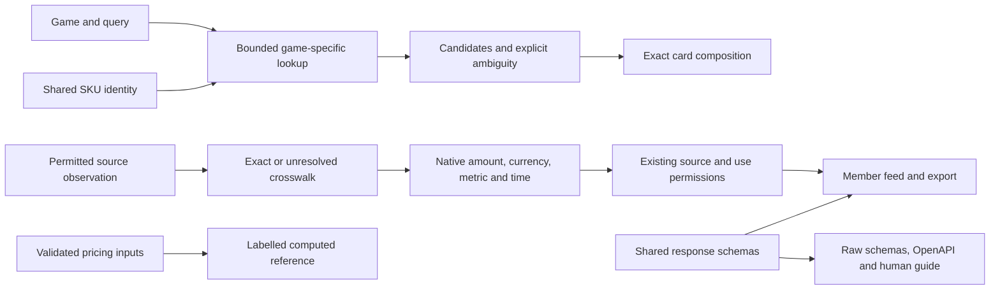

# Card identity and price contracts

The rebuild's data foundation joins three existing packages: SKU identity in
`@cambridge-tcg/sku`, monetary computation in `@cambridge-tcg/pricing`, and response
semantics in `@cambridge-tcg/data-spec`. It serves both human card pages and API
clients. It does not turn syntax into verified printing identity, authorize a
source, fetch a new price feed or reopen paid commerce.

## Contract ownership

| Responsibility | Owner | Meaning |
|---|---|---|
| Canonical syntax and explicit normalization candidate | `packages/sku/src/identity.ts` | Preserve the stored key; expose parsed identity alongside it |
| Candidate lookup | `apps/storefront/src/lib/search/catalog-lookup.ts` | Keep the requested game fixed; label bounded/incomplete retrieval |
| Candidate scoring | `apps/storefront/src/lib/search/resolver.ts` | Exclude unrelated/cross-game rows; preserve uncertainty |
| Money representation and calculations | `packages/pricing/src/money.ts`, `index.ts` | Explicit major units; valid finite inputs and deliberate rounding |
| Native/member observation type and schemas | `packages/data-spec/src/price-observation.ts`, `schemas/price-observation.ts` | One source of truth for existing observation wire fields |
| Ingestion compatibility export | `packages/data-ingest/src/member-prices.ts` | Existing import paths keep working; no duplicate observation interface |
| Member response projection | `apps/storefront/src/lib/prices/member-feed.ts` | Check core stored monetary/mapping values after source/use filtering |
| Public discovery | `apps/storefront/src/lib/contracts` | Describe contracts without publishing private observations |

## Identity rules

`identity` is additive in search matches and card composition. `raw_sku` remains
the existing storage key; `canonical_sku` is a normalized candidate. The scope is
always `syntax_only`. Game registration is not catalogue availability; a
two-letter language shape is not ISO membership or proof of printing language.
Leading zeros and variant token order remain significant.

Search never substitutes another game's matching set. A complete lookup with
one exact printing can compose a card. Multiple printings, an unavailable
requested language or incomplete candidate retrieval retain the choices.
`summary.ambiguous` retains its older set/number-group meaning; it is not a
promise that only one printing exists. Check `lookup.truncated` and the actual
matches. A source outage returns 503 instead of a successful empty result.

## Monetary rules

- Existing numeric `*_gbp` fields remain pounds, with their existing `null` and
  publication semantics. They are not converted to integer pennies.
- Generic money carries a decimal string, currency and `unit: "major"`. Zero is
  valid there. No exchange rate or settlement precision is inferred.
- Native observations preserve positive decimal text and EUR/USD source
  currency. Zero sentinels remain rejected; missing source values create no
  observation. No guessed FX conversion or cross-source average is introduced.
- Exact source mappings carry `sku` and `setCode`; ambiguous/unmapped records
  carry neither. Keep granularity, finish, language and condition separate.
- `sourceUpdatedAt`, `retrievedAt` and pagination `asOf` have different meanings.
- Invalid explicit channel quotes remain unavailable instead of triggering a
  different fallback quote. Shared computation rejects nonfinite inputs, invalid
  rates and unsupported rounding configuration; callers handle this explicitly.

Runtime member checks validate core values and mapping consistency. They do not
run the entire JSON Schema against each response, prove source correctness or
replace the publication policy. Schema conformance is tested using fixtures.

## Public entry points

- `/standards/card-data`: human guide.
- `/api/v1/contracts/card-data`: versioned descriptor in the existing envelope.
- `/spec/v1/{schema}`: allowlisted raw schemas at their declared `$id` URLs.
- `/api/openapi.json`: shared money, observation, identity and envelope schemas.
- `/api/v1/identifiers/validate`: existing bounded stateless validator.

The curated manifest and agent guide link these entries. Schema URLs contain no
credentials or source records. Example identifiers demonstrate syntax only.
The envelope schema accepts extension metadata while validating its standard
fields; OpenAPI imports that schema so the two cannot drift independently.

## Remaining work

The first implementation connects search, composition and the member feed. Other
legacy identifier consumers and price APIs still require individual migration
and contract review. Source availability, catalogue correctness, upstream rights
and production activation are separate checks; the local fixture suite does not
establish them. The next card-page rebuild should consume these contracts and
display exact, ambiguous, unavailable and withheld states distinctly.
