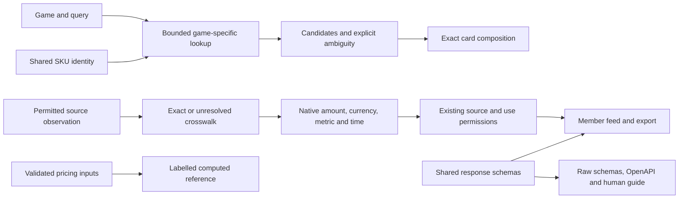

# Card-data foundations

The rebuild's data foundation joins three existing packages: SKU identity in
`@cambridge-tcg/sku`, monetary computation in `@cambridge-tcg/pricing`, and response
semantics in `@cambridge-tcg/data-spec`. It serves both human card pages and API
clients. It does not turn syntax into verified printing identity, authorize a
source, fetch a new price feed or reopen paid commerce. The
[data-platform roadmap](../plans/tcg-data-platform/README.md) sequences the four
foundations: SKU identity, images, prices and market observations. This page
records current ownership and limits, rather than duplicating that plan.

## Contract ownership

| Responsibility | Owner | Meaning |
|---|---|---|
| Canonical syntax and explicit normalization candidate | `packages/sku/src/identity.ts` | Preserve the stored key; expose parsed identity alongside it |
| Candidate lookup | `apps/storefront/src/lib/search/catalog-lookup.ts` | Keep the requested game fixed; label bounded/incomplete retrieval |
| Candidate scoring | `apps/storefront/src/lib/search/resolver.ts` | Exclude unrelated/cross-game rows; preserve uncertainty |
| Money representation and calculations | `packages/pricing/src/money.ts`, `index.ts` | Explicit major units; valid finite inputs and deliberate rounding |
| Native/member observation type and schemas | `packages/data-spec/src/price-observation.ts`, `schemas/price-observation.ts` | One source of truth for existing observation wire fields |
| Ingestion compatibility export | `packages/data-ingest/src/member-prices.ts` | Existing import paths keep working; no duplicate observation interface |
| Observation write boundary | `apps/storefront/src/lib/datafeed/member-price-writer.ts` | Apply shared normalized-value checks before a transaction, then require provenance and source/use evidence |
| Member response projection | `apps/storefront/src/lib/prices/member-feed.ts` | Check core stored monetary/mapping values after source/use filtering |
| Public discovery | `apps/storefront/src/lib/contracts` | Describe contracts without publishing private observations |
| Image storage and EN reference lookup | `apps/storefront/src/lib/cards/en-card-data.ts` | Shared official-image checks and reference metadata; independent readers and removal remain separate work |
| Standards registry | `apps/storefront/src/lib/contracts/standards.ts` | One registry for `/standards` and `/standards.json`; versions do not imply industry adoption or current coverage |
| Roadmap snapshot | `apps/storefront/src/content/platform/index.ts` | Shared authored plan for `/roadmap` and `/api/v1/roadmap`; not a runtime capability report |

## Identity rules

`identity` is additive in search matches and card composition. `raw_sku` remains
the existing storage key; `canonical_sku` is a normalized candidate. The scope is
always `syntax_only`. Game registration is not catalogue availability; a
two-letter language shape is not ISO membership or proof of printing language.
Leading zeros and variant token order remain significant.

Search never substitutes another game's matching set. A complete lookup with
one unambiguous catalog match can compose a card; this does not verify a physical
printing. Multiple printings, an unavailable
requested language or incomplete candidate retrieval retain the choices.
`summary.ambiguous` retains its older set/number-group meaning; it is not a
promise that only one printing exists. Check `lookup.truncated` and the actual
matches. A source outage returns 503 instead of a successful empty result.

## Monetary rules

- Existing numeric `*_gbp` fields remain pounds, with their existing `null` and
  publication semantics. They are not converted to integer pennies.
- Generic money carries a decimal string, currency and `unit: "major"`. Zero is
  valid there. No exchange rate or settlement precision is inferred.
- Native observations preserve positive decimal text and EUR/USD source
  currency. Zero sentinels remain rejected; missing source values create no
  observation. No guessed FX conversion or cross-source average is introduced.
- Exact source mappings carry `sku` and `setCode`; ambiguous/unmapped records
  carry neither. Keep granularity, finish, language and condition separate.
- `sourceUpdatedAt`, `retrievedAt` and pagination `asOf` have different meanings.
- Invalid explicit channel quotes remain unavailable instead of triggering a
  different fallback quote. Shared computation rejects nonfinite inputs, invalid
  rates and unsupported rounding configuration; callers handle this explicitly.

The writer and member reader share `assertPriceObservationValues`. Raw source
numbers may become decimal strings during parsing; normalized observations must
already use strings and cannot contain trailing line terminators. Currency and
underlying market must agree. Cardmarket keeps EUR product-level scope with
unknown language and condition; Scryfall retains printing scope. Exact mappings
require nonempty string SKU/set values, while unresolved mappings retain null.
These rules also appear in the native/member JSON Schemas.

Invalid writes fail before opening a transaction. An inconsistent stored row
makes its bounded response page unavailable; no partial page or fabricated
replacement price is emitted. This does not alter historical data, refresh its
source clock or activate acquisition. Runtime checks validate core values and
mapping consistency; they do not execute the full schema, verify a printing or
replace permission/provenance checks. Schema conformance and existing parser
compatibility are tested using fixtures.

**2026-09-29 verification:** the observation/schema, source parser, writer and
member-feed suites passed 106 tests in the integrated worktree. Data-spec and
data-ingest typechecks also passed against the private proposal. Broader release
checks are recorded separately. These fixtures make no production-data or
provider-health claim.

## Image and market boundaries

Legacy wholesale images and the card composer's image fields remain withheld.
The universal-card path separately calls `getEnCardData()`. Its shared official
image projection validates source, attribution, retrieval metadata, self-hosted
object and takedown state. The lookup strips language and variant to an English
base key and labels the result as a reference, without an exact-printing claim.
Existing image fields remain alongside additive `image_reference` metadata.

The [recorded chronology](../EN-CARD-DATA.md) shows that attributed effect text
and attributes were approved after the initial images-only decision on 13 July.
They remain available under that recorded scope. The automated Bandai reader
stays paused; old source-registry prose does not accurately describe every
current display path. Market catalogue fallback was deliberately added on
16 July and remains a separate, unverified lane.

Starter/practice adds a separate `CardNumberImageReference` schema because an
encoded deck requests a card number, not a printing SKU. It retains selected
English reprint/parallel identifiers and credit, sharing the image publication
checks without changing the existing base-only `ImageReference` shape.

The [image-reference architecture](card-image-references.md) maps the remaining
gallery, artist and retained PvP readers, incomplete printing/credit joins and cache
removal work. The first shared reference mechanism is not a complete reusable
image-record schema or a global takedown guarantee. Storage, self-hosting and
attribution do not establish a reusable image licence.

Existing market, listing and history paths are not a unified market-data feed.
Source asks, completed sales, aggregates and computed reference prices require
distinct meanings and compatible identity/time dimensions. Personal trading
records and retained agreement code do not establish publication permission.

## Public entry points

- `/standards/card-data`: human guide.
- `/api/v1/contracts/card-data`: versioned descriptor in the existing envelope.
- `/spec/v1/{schema}`: allowlisted raw schemas at their declared `$id` URLs.
- `/api/openapi.json`: shared money, observation, identity, image-reference and envelope schemas.
- `/api/v1/identifiers/validate`: existing bounded stateless validator.
- `/standards` and `/standards.json`: the three existing specification entries.
- `/roadmap` and `/api/v1/roadmap`: static planning snapshot, explicitly separate
  from runtime availability and provider activation.

The curated manifest and agent guide link these entries. Schema URLs contain no
credentials or source records. Example identifiers demonstrate syntax only.
The envelope schema accepts extension metadata while validating its standard
fields; OpenAPI imports that schema so the two cannot drift independently.

## Remaining work

The first implementation connects search, composition and the member feed. Other
legacy identifier consumers and price APIs still require individual migration
and contract review. Source availability, catalogue correctness, upstream rights
and production activation are separate checks; the local fixture suite does not
establish them. The next card-page rebuild should consume these contracts and
display exact, ambiguous, unavailable and withheld states distinctly. The
reference packages are private workspaces. Code licensing, anonymous repository
access, reproducible package releases and upstream data rights remain separate
checks; no public download or industry adoption is implied.
