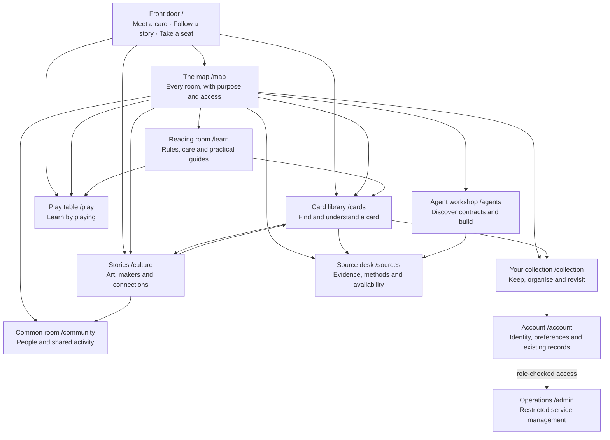

# Cambridge TCG — a new place for cards

**Draft for discussion · 2026-09-29 · source baseline `f2a8359b`.**

Yu's confirmed scope is a fresh content, room, page and UI architecture, keeping
useful backend services after reviewing their contracts. This is a complete
storefront design brief, including personal and operator spaces. The earlier
UI cleanup is a recoverable baseline, not the proposed final experience.
Implementation has not started. Room names, URLs and layouts below are proposals.

## Purpose

Cambridge TCG is a place to understand cards, care for a collection, enjoy play,
and follow the people and ideas around them. Someone can arrive with a card
number, a question, a favourite character, or simple curiosity and find a useful
way in.

Artbitrage supplies the editorial model: begin with something concrete, help
the reader notice it, give it context, and offer a reason to continue. Cambridge
should feel like connected rooms with something worth discovering in each one.
Its forms, navigation and status messages remain direct and easy to use.

New paid commerce remains retired. Existing agreements, records and support keep
their proper home. The old [purpose document](../../purpose.md) still describes a
commerce-led platform; replacing that framing is part of the first design phase.

## Read the plan

| Document | Question it answers |
|---|---|
| [Rooms](rooms.md) | What belongs here, who is it for, and what can someone do? |
| [Content and design](content-and-design.md) | What does an Artbitrage-inspired Cambridge page actually say and look like? |
| [Architecture and wiring](architecture.md) | How do pages, content, modules, services and machine interfaces connect? |
| [Module roles](module-roles.md) | What happens to each existing application and shared package? |
| [Delivery and decisions](delivery.md) | In what order do we design, build, migrate and verify the whole site? |
| [Route inventory](route-inventory.csv) | Where is every existing page and API handler assigned for review? |
| [Inventory notes](inventory.md) | What does the inventory cover, and what remains unverified? |

The existing [module catalog](../../modules/catalog.json) continues to describe
current source. This plan describes proposed ownership and migration; it is not
a second live endpoint registry.

## The proposed place

The room names provide character; plain subtitles explain the task. Visitors do
not have to learn a metaphor to find search, a deck, an order or an API schema.
The map is an editorial directory. Private records never enter its public data.

## How someone arrives

- **With a card:** a persistent search leads to one card identity, its available
  details, source status, related reading and collection actions when permitted.
- **With curiosity:** a featured, credited object or short story leads through a
  few deliberately chosen rooms. Each connection explains what to notice next.
- **To play:** an obvious practice route distinguishes browser-only saves from
  server-recorded matches and rewards.
- **With an existing account or agreement:** Account remains easy to find;
  support and obligations do not disappear inside the editorial experience.
- **As an API client:** Agents opens public discovery and exact contracts first.
  Optional cultural writing is available through an explicitly labelled link.

## What we know

The baseline contains **297 page files, 467 route handlers, 74 top-level route
families, 68 library directories and 28 documented module roots**. These counts
describe source, not working deployments or distinct live features.

The important problems are structural: competing card entrances, a map mixing
visitor navigation with repository doctrine, historical commerce language,
content and controls embedded together, and service names that hide side
effects. For example, the portfolio GET handler saves a snapshot; “GET” alone
does not establish a read-only interaction.

We will preserve useful domain logic, identifiers, records and contracts while
rebuilding the experience that presents them. Every current page receives a
decision: rebuild, combine, retain as a record, redirect with an explicit mapping,
or preserve as a clearly labelled experiment/archive. No blanket deletion or
catch-all redirect is proposed.

## Decisions and progress

| Item | State |
|---|---|
| Fresh content, rooms, pages and UI | Confirmed by Yu |
| Retain useful backend services | Confirmed; each service still needs a contract/effect review |
| Artbitrage-style connected content | Confirmed direction |
| Readable, purposeful interface without elaborate decoration | Carried forward from Yu's earlier brief |
| Eight content rooms plus entry, map, account and operations | Proposed |
| New canonical paths and exact room names | Proposed; aliases and parameters must be reviewed |
| Existing commerce, publication and authentication boundaries | Current constraints carried into the rebuild |
| Plan and source inventory | Drafted for review |
| New room content, wireframes, application code and migration | Not started |

The next concrete design step is a small set of connected page wireframes with
real sample writing: front door, map, card, story, collection and play. Their
content and behaviour should settle before the new component system is built.
