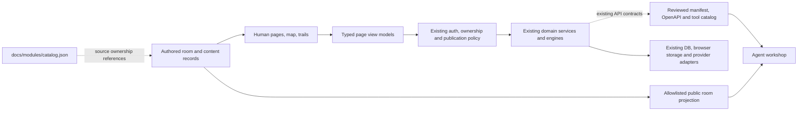

# Architecture and wiring

[Plan entry](README.md) · Proposed structure, grounded in source at `f2a8359b`.
Existing implementation paths below are relative to `apps/storefront/src/`.

## Separate four responsibilities



1. **Room/content records** own names, purpose, writing and editorial connections.
2. **Page composition** owns presentation, forms, navigation and accessible state.
3. **Domain adapters/view models** assemble only permitted fields and actions.
4. **Existing services** own business rules, persistence, auth and provider effects.

A room can contain several pages and use several modules. A package can support
several rooms. Neither the room registry nor menu visibility grants permission.

## One authored directory, several projections

Proposed room record:

```ts
type Room = {
  id: string;
  title: string;
  taskLabel: string;
  purpose: string;
  canonicalPath: string;
  contentRef: string;
  relatedRoomIds: string[];
  modulePaths: string[];       // references the existing module catalog
  serviceRefs: string[];       // references existing reviewed contracts
  accessDescription: string;  // explanatory text, never enforcement
  editorialState: "draft" | "published" | "archived";
};
```

Page/content records add a stable ID, parent room, language, writing register,
authorship, sources, review date and trail links. A trail stop names a page/anchor
and explains why it follows the previous stop. Page IDs survive URL changes.

Derive navigation, breadcrumbs, the room map and editorial connections from that
directory. Public JSON is an explicit allowlisted projection: room title, purpose,
public entrance, register and approved links. Exclude private record IDs, internal
service names, credentials, deployment paths and operator details.

Runtime availability is separate from editorial state. “Published article,”
“source unavailable,” “sign-in required” and “server writes paused” are different
facts. A static room record must not assert that a service is live.

Keep `lib/manifest.ts`, `lib/agent-tools-catalog.ts`, the OpenAPI implementation
and public-discovery helpers authoritative for their contracts. The 467-file API
inventory is a contributor audit artifact, not a public discovery feed. A proposed
room JSON endpoint needs an explicit reviewed route before it is advertised.

## Proposed source organisation

```text
apps/storefront/src/
  app/                       thin route entries; explicit migration adapters
    (site)/                  public room pages and reading/search views
    (personal)/              authenticated personal task pages
    admin/                   complete restricted operator surface
    api/                     existing contracts retained during migration
  content/
    rooms/                   authored directory and room introductions
    readings/                trusted guide/story records and source references
    trails/                  ordered page IDs and reasons to continue
  components/
    site/                    new shell, map, room, reading and navigation pieces
    cards/ collection/ play/  domain presentation, without business-rule copies
  lib/
    rooms/                   validation and safe directory projections
    <existing domains>/      existing service logic plus small typed view adapters
    ui/                      shared controls and layout primitives after review
```

This is a target ownership pattern, not a move script. Route groups do not change
URLs or provide auth by themselves. Keep moved imports and client/server
boundaries explicit. Existing tested primitives may be retained after they fit
the new design; the current page compositions are not binding.

No existing MDX setup was found in the app's package/config review. Start with
trusted content records and ordinary server rendering. Add Markdown/MDX tooling
only if the reviewed authoring workflow needs it; never execute user submissions
as trusted content. Public content and private records use separate pipelines.

## Journey wiring and effects

| Room / journey | Existing wire | Effect and rebuild requirement |
|---|---|---|
| Find a card | `app/prices/search/page.tsx::fetchEverything` → `/api/v1/search/everything` → `lib/search/resolver.ts`, then card everything endpoint | Preserve exact/ambiguous matches and source state. Avoid a second search interpretation in UI code. |
| Browse permitted card details | `lib/wholesale/client.ts` and `lib/public-wholesale-fields.ts` | Server projection must withhold unreviewed prices/images and disallow indirect sorting by withheld values. Hiding fields with CSS is insufficient. |
| Inspect source evidence | `lib/prices`, `lib/coverage-hunt`, `lib/data-pantry`, source rights helpers | Return only reviewed public/member fields; timestamp retrieval separately from publication permission. |
| View personal collection | `app/api/portfolio/route.ts` → `valuatePortfolio` + `saveSnapshot` in `lib/portfolio/db.ts` | **Effectful GET:** valuation can backfill `image_url`; handler saves a snapshot. Do not prefetch/crawl as a pure read. Specify or separate these effects before new wiring. |
| Edit a collection | `addCard`, `updateCard`, `removeCard`, `getUserCards` in portfolio service | Retain owner checks and explicit mutations. Review `getListingActions`, which still emits retired selling/auction actions. |
| Play locally | `app/play/adventure/[levelId]/page.tsx` → `PracticeBoard`, adventure levels and existing engine | Browser state only; expose save/reset meaning. Server status must not block local practice. |
| Inspect saved PVE | `/api/game/pve/**` and `lib/game/pve-availability.ts` | Durable mutations and rewards remain paused by policy. Do not infer an open write path from visible historical records. |
| Browse organisations | `/api/v1/directory/organisations` → `listPublicCollectives` | Public projection deliberately excludes members, counts and steward identities. |
| Community activity/settings | `/api/social/feed`, `/api/social/profile`, `lib/social/publication.ts` | Activity needs current forward-only publication receipts. Profile, activity and messaging are separate choices; do not publish private wishlists or IDs. |
| Private matches/messages | `/api/social/matches`, messages and notifications services | Authenticated, purpose-specific permissions; preserve existing conversation and validated trade-context exceptions. Public directory data must not be used to infer private participation. |
| Existing agreements | Account order/trade/remedy pages and existing market/auction/escrow/payment helpers | Preserve records and current remedies. New paid commerce remains retired. Existing trade payment creation also has its own release gate; retained does not mean enabled. |
| Machine discovery | `/api/v1/manifest` → `lib/manifest.ts`; OpenAPI; `/api/mcp/catalog` | Reviewed discovery is public where its contract says so; not a promise every route is supported or callable. |
| Agent execution | `/api/mcp` → `lib/agents/auth.ts`, `tool-access.ts::canInvokeAgentTool` | Invocation resolves scoped authority. Reads can consume rate budget/update usage; paused writes and bounded operator contributions remain explicit. |
| Operator work | `lib/auth/realms.ts::requireAdminPage`, `lib/admin/auth.ts::requireAdmin`, `adminAction`, `logAdminAction` | Retain role, ownership and audit boundaries; preserve `safe`/`safeCount` unavailable semantics. Rebuild all active admin page families. |
| Jobs and callbacks | Cron routes, `lib/cron-auth.ts`, signed provider handlers | Exclude from browsing/prefetch/preview crawls. Maintenance GET performs mutations and has a development-only auth exception; inspect the actual route, not just the generic helper. |

The first service review classifies each connection as static, read, browser-local
write, private write, publication write, provider action or background job. HTTP
method alone is not that classification. Discovery is read-only in this planning
pass; no live database or provider behaviour was verified.

## Authentication and data boundaries

Reuse the current session and role implementation. `proxy.ts` currently matches
account/admin paths and performs an optimistic cookie-presence check. A new
`/collection` URL is not automatically protected by that matcher. Its private
pages and APIs require real server-side session/ownership checks, with reviewed
proxy routing and safe return paths where appropriate.

Use public, member, owner and operator response types where their data differs.
Private records must not enter public HTML, RSC payloads, generated content,
search indexes, static maps or error logs. Validate at the server boundary before
passing a view model to client components.

Keep account agent-key management outside public content. Example requests use
placeholders. Credentials stay in the selected provider vault/Keychain or scoped
server environment; no `.env` copying or ambient credential loading is part of
the rebuild. Existing historical exposure and rotation decisions remain separate
from source cleanup.

## URL migration is a contract

- Review `/catalog`, `/prices`, `/find`, `/product/[sku]`, `/cards/[sku]` and
  `/cards/[sku]/market` individually. Game code, slug, language, variant, sort and
  pagination parameters are not interchangeable. Preserve meaning with explicit
  adapters; do not bulk replace prefixes.
- Preserve deep links, fragments and saved filters for reading pages where
  possible. Split/combined essays need a section mapping, not an unexplained home
  redirect. `/workshop` stays cultural; `/card` stays creative.
- Keep API methods, body schemas, status codes and side effects stable while the
  UI moves. Do not redirect mutations as a side effect of renaming a room.
- Keep account callbacks, mail links, provider callbacks, webhook paths and
  operator routes stable until separately reviewed. Preserve existing retired
  admission responses and settlement gates.
- Do not generate blanket redirects for the 297 pages. The migration ledger
  needs a destination, owner, access rule, parameter/fragment mapping and a test
  for every affected route. Unresolved rows remain preserved.

The [route inventory](route-inventory.csv) starts that ledger with room ownership
and review categories. It is not yet an approved redirect table.
