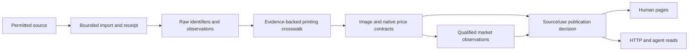

# TCG data platform roadmap

Reviewed **2026-09-29**. Cambridge TCG is building open-source tools and shared
standards for card identity, images, prices and market observations. This is a
dependency-ordered implementation plan, with no promised release dates or live
coverage claims.

The [platform registry](../../../apps/storefront/src/content/platform/index.ts)
owns the public milestone IDs, summaries and status used by `/roadmap` and
`/api/v1/roadmap`. This document expands those milestones for implementation.
[Provider integrations](integrations.md) records external evidence and rollout
gates; [the agent layer](agent-layer.md) separates existing access from planned
capabilities. The [storefront rebuild plan](../storefront-rebuild/README.md)
continues to cover the wider pages and room structure.

## Foundations already present

| Area | Implemented foundation | Remaining gap |
| --- | --- | --- |
| Identity | [SKU package](../../../packages/sku/src/index.ts): syntax, game registry, normalization and raw/canonical identity. Public validation and bounded catalog lookup exist. | Syntax validity does not establish an exact printing or provider-product match. Preserve raw lookup keys and add evidence-backed crosswalks. |
| Images | [English card helper](../../../apps/storefront/src/lib/cards/en-card-data.ts) shares source checks and base-reference metadata with market/universal consumers. Starter/practice uses the same checks with a separate card-number reference, preserving image suffixes and credit. | Consolidate independent gallery/artist/retained PvP readers, review legacy catalogue fallbacks, and verify removal across objects and caches. Reference metadata does not establish an exact printing. |
| Prices | [Observation types](../../../packages/data-spec/src/price-observation.ts), [schemas](../../../packages/data-spec/src/schemas/price-observation.ts), source parsers, a transactional writer and a bounded [member feed](../../../apps/storefront/src/lib/prices/member-feed.ts) exist. | Source admission and imports determine availability. Member access does not establish permission for public redistribution. |
| Market | Existing order books, account records and settlement services; [publication controls](../../../apps/storefront/src/lib/market/publication.ts) pause completed-sale and private-interest derivatives. | There is no unified, qualified market feed. New paid commerce remains retired; existing obligations retain their lifecycle. |
| Agents | [Discover / Read / Contribute entrance](../../../apps/storefront/src/app/agents/page.tsx), manifest, OpenAPI, contract descriptor, tool catalog and authenticated dispatcher. | Broader contribution workflows, independently distributed clients and conformance tooling remain planned. |

The code registry records a One Piece Cardmarket member-price import on
2026-09-08 and manual refresh only. This review did not query production to
confirm current row counts, freshness or service health.

## Delivery stages

The proposed integration path shares identity and permission decisions across
every output. Existing services provide the seams; the full path is not yet a
released pipeline.

### P0 — Reconcile the foundations (`baseline`, in progress)

Inventory each public, member and agent projection and reconcile its image,
text and price release policy. Record acquisition, storage, display, API and
download permissions separately, with their evidence and review version.

The first image step keeps the existing English base lookup, validates official
image metadata and adds an explicit reference relationship to its single/batch
consumers. The next connection carries card-number references and attribution
through starter/practice responses and browser saves, with bounded optional media
loading and a full encoded deck when images are unavailable. Neither makes an
exact-printing claim. The
[image architecture](../../architecture/card-image-references.md) records its
bounded scope and remaining readers.

The [decision chronology](../../EN-CARD-DATA.md) matters: the 13 July image
decision was followed that day by an attributed-text/attributes decision, and
the 16 July market change intentionally retained catalogue-photo fallback.
Older “text withheld” and “all publication paused” prose is not the latest
recorded owner intent. Existing text remains; automated Bandai ingestion stays
paused. Catalogue fallbacks are labelled unverified, and gallery/artist/retained PvP
readers and cache/object removal still need reconciliation. Hosting, attribution
or a clear database flag does not independently establish redistribution rights.

**Ready when:** the same fixture receives consistent field-level decisions
through human and API paths; unknown rights stay withheld; attribution remains
attached; removal reaches caches; applicable licensing notices are consistent; release
scans and reproducible local build evidence are recorded.

### P1 — Make identity dependable (`identity`, planned)

Define a versioned printing identity and provider crosswalk. Preserve source ID,
source scope, raw SKU, normalized syntax, game, set, collector number, language,
finish and variant. Give exact, ambiguous and unmapped records distinct states;
record supporting evidence, mapping version and correction history.

**Ready when:** golden fixtures cover aliases, leading zeros, language variants,
reprints, collector-number suffixes and finishes without silent merges. Exact
mapping requires evidence beyond a matching name or normalized SKU. Image and
price joins use the reviewed identity and source scope; unresolved records
remain independently inspectable without acquiring a guessed SKU.

### P2 — Connect images and prices (`observations`, planned)

Extend the bounded image-reference contract to carry requested and depicted identity, exact/reference
relationship, face, language, source, credit, allowed uses, dimensions, checksum
and removal status. Reuse the current native-price contract rather than create
an incompatible second amount representation.

Preserve positive decimal-string major-unit amounts, native currency, source
metric, finish, language, condition, granularity, source update time, retrieval
time, parser/crosswalk versions and permission evidence. Generic money can
represent zero; the current source-price parsers quarantine zero rather than
publish it as a real price. Missing values remain missing. Pagination snapshot
time is not source freshness. Any future FX view must retain its original
amount plus the rate, source and conversion time.

**Ready when:** shared fixtures validate API/UI/export parity, exact versus
reference imagery, zero/null/invalid values, corrections and removal. Comparison
requires compatible identity, metric, currency, condition and time; it never
manufactures an average across incompatible inputs.

### P3 — Pilot permitted providers (`integrations`, planned)

Extend the existing Cardmarket and Scryfall seams after their source/use review;
evaluate TCGdex for multilingual Pokémon catalog coverage. Preserve source-native
unmapped observations while exact crosswalks are reviewed. Deprecation of the
existing Pokémon TCG API is a migration input, not permission to switch feeds
without reviewing the replacement. See the [provider matrix](integrations.md).

**Ready when:** imports have bounded requests, byte/deadline limits, replay
receipts, quarantine counts and rollback/revocation behavior. Re-reading an
artifact creates neither duplicate history nor a fresh source timestamp.
Report eligible coverage, mapping quality, unavailable sources and stale data
separately. A successful empty result must remain distinguishable from failure.
Scheduling and production activation are separately reviewed release steps.

### P4 — Release interoperable tools (`distribution`, planned)

Prepare independently usable packages, versioned conformance fixtures and
human/client examples. Expose permitted observations through a shared read and
publication layer. Define listing asks, bids, completed sales, provider indices
and computed references as distinct observation kinds.

**Ready when:** an external consumer can retrieve the declared release, build
or install it, resolve its schemas and reproduce fixtures. Compatibility,
correction and deprecation rules are documented. Aggregates disclose scope,
sample, exclusions and delay; personal trading records have a reviewed
publication basis. Public, member and agent outputs enforce the same source/use
decisions without weakening their different authentication boundaries.

## Release and licensing gate

The root [LICENSE](../../../LICENSE) declares Apache-2.0 for repository code.
The [standards declaration](../../STANDARDS-LICENSE.md) dedicates specification
prose to CC0. Neither declaration makes provider prices, card images,
operational records or every mixed API response CC0.

The SKU, data-spec and data-ingest package manifests currently mark them
`private: true` and export workspace source. On 2026-09-29, unauthenticated
checks of the GitHub repository reference and license API returned 404. This
does not establish whether the repository is absent or private, and does not
verify a public release. Do not advertise public clone access, npm installation
or an independently released conformance suite until checked.

Before release, verify the intended repository visibility, exact release/tag,
artifact contents, applicable code/specification notices, dependency licenses,
credential exclusion and source-data exclusions. Record anonymous access and
clean-consumer installation/build results. Publish only through the authorized
release process; this roadmap does not deploy, change visibility or rotate keys.
